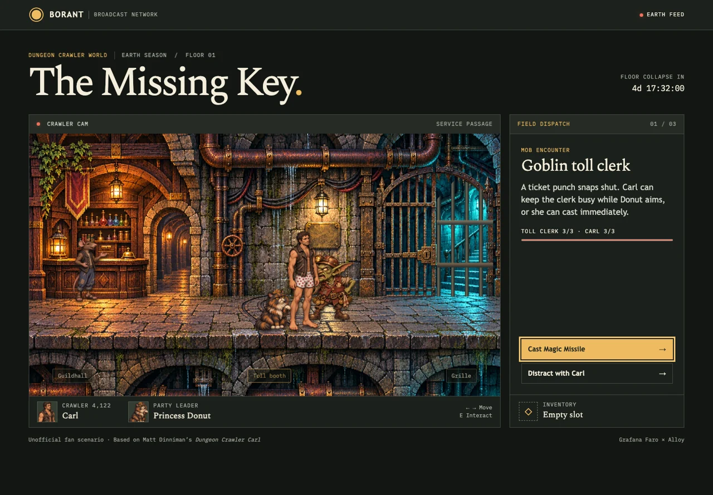

# The Missing Key

Play Carl and Princess Donut on the first floor of an intergalactic reality show. A goblin toll clerk stands between the party and the stairs. Later, the Dungeon AI congratulates Carl on receiving a brass key. His inventory slot is empty. Take the Borant duty desk and use real browser telemetry to find out what happened.



[Watch the short gameplay and Grafana preview](media/preview.mp4)

## Start the broadcast

Allow about ten minutes. You need Docker with Compose and free host ports 8088 (game), 3000 (Grafana), 3100 (Loki), 12345 (Alloy UI), and 12347 (Faro receiver). From the repository root, run:

```sh
cd dungeon-crawl-live
docker compose --env-file ../image-versions.env -f docker-compose.yml -f docker-compose.coda.yml up --build -d
```

Open [the game](http://localhost:8088). Move with Left/Right or A/D. Press E for the first dispatch action, or use Tab and Enter to choose either action. On touch screens, tap a destination on the map and choose an action in the dispatch panel.

For a split installation, run `./run-example.sh dungeon-crawl-live` and `./coda start dungeon-crawl-live` from the repository root. Set `GRAFANA_URL` to the browser-visible Grafana origin when using a hosted lab. The game forwards Faro requests to Alloy on the Docker host. Override `FARO_COLLECTOR_URL` when the game needs a different internal route to Alloy.

## Play one shift

1. Approach the toll booth and challenge the clerk. Try Donut’s Magic Missile and see how the clerk responds. Carl can distract him to give Donut a clean shot. Winning earns a crawler box.
2. Take the unopened box to Mordecai in the Tutorial Guildhall. Open it, equip the key, unlock the grille and descend. The floor clock keeps running inside the safe zone.
3. Choose **Replay with HUD 1.1**. The training replay begins at the guildhall with the same box already earned. Open it, walk to the grille and try to unlock it.
4. Select **Investigate this run**. In Grafana, compare keys issued, usable slots and descents by HUD release. The duty log follows the selected attempt in chronological order. Expand an error row to inspect its stack. Grafana refreshes every five seconds.
5. Decide whether the reward service issued the key, which step failed in the browser, and which release you would restore. Use **Return to operator checkpoint** on the dashboard, select **Roll back inventory display**, then replay the checkpoint and verify recovery in Grafana.

<details>
<summary>Operator’s answer</summary>

Both releases receive the same brass key. HUD 1.1 reads the alt text of an optional thumbnail that this item lacks. The inventory renderer throws after the service commits the reward. Faro captures that exception and its stack. Reopening the box returns the existing grant. The working HUD renders the item, enables equipping it and records descent when both crawlers pass the grille.

For a single complete shift, expect three grants, two usable slots and two descents. Both successes belong to HUD 1.0. The release comparison includes other runs within the dashboard’s time window. The selected-attempt filter applies to the duty log.

</details>

## Follow the telemetry

The browser sends Faro events, exceptions and timing measurements through the game’s same-origin `/collect` endpoint to Alloy’s `faro.receiver`. Separately, the reward service commits one JSON receipt per attempt on a shared Docker volume. Alloy tails those receipts, drops the filename label, and sends both streams to Loki. Grafana counts distinct run IDs by HUD release. The service and browser use event timestamps to reconstruct the order of play.

Open [Grafana Explore](http://localhost:3000/explore), select **Dungeon telemetry**, and compare:

```logql
{service_name="crawler-hud"} | json | kind="exception"
```

```logql
{service_name="reward-service"} | json | event_name="key_granted"
```

The `page_attr_run_id` field on browser records matches `run_id` on the receipt. Faro also records a browser session ID shared by attempts in the same session. [Alloy receiver reference](https://grafana.com/docs/alloy/latest/reference/components/faro/faro.receiver/)

## Repeat the end-to-end check

With the stack running, install Node.js 24 or later, then run:

```sh
cd app
npm ci
npx playwright install chromium
npm run test:e2e
```

The desktop keyboard and emulated phone touch journeys each fight the mob, open Grafana, inspect the failed attempt, restore the working HUD and verify the emitted records in Loki. Set `GAME_URL` and `LOKI_URL` for custom host ports.

To stop a combined deployment, run this from the scenario directory:

```sh
docker compose -f docker-compose.yml -f docker-compose.coda.yml down
```

For a split installation, use `./coda stop dungeon-crawl-live` from the repository root and run `docker compose down` in the scenario directory.

## Credits

An unofficial fan scenario based on Matt Dinniman’s *Dungeon Crawler Carl*. Carl, Princess Donut, Mordecai and the dungeon setting belong to the series. The toll clerk, passage and software incident were created for this exercise. The scenery and character illustrations are original AI-generated game assets. [Book One publisher excerpt](https://cdn.penguin.co.uk/dam-assets/books/9780241816264/9780241816264-sample.pdf)
