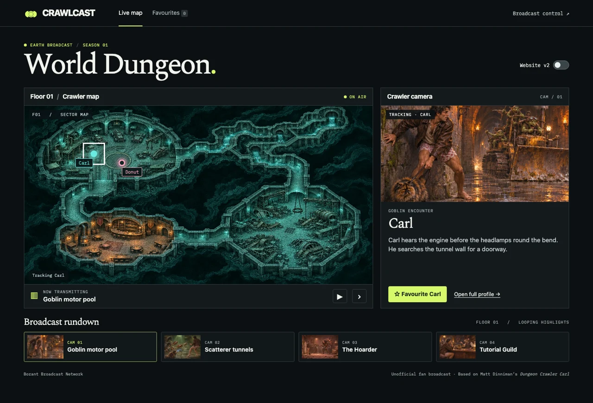

# Crawlcast · World Dungeon broadcast

You’re watching Borant’s coverage of the first floor. Two signals on the map belong to Carl and Princess Donut. Tune in to either crawler, follow their camera through four highlights, and favourite them so you can find their feed again. Then switch website versions and investigate what changes for the audience.



[Watch the short broadcast and Grafana preview](media/preview.mp4)

## Open the broadcast

From the repository root, start the website and monitoring stack:

```sh
cd dungeon-crawl-live
docker compose --env-file ../image-versions.env -f docker-compose.yml -f docker-compose.coda.yml up --build -d
```

Open [Crawlcast](http://localhost:8088). The map runs on its own. Click or tap a crawler’s coloured signal, or use Tab and Enter to select it. Each camera has two commentary beats before the director cuts to the next room. Use the pause and next controls or choose a shot in **Broadcast rundown**.

The edit loops from the goblins’ murder dozer to the Scatterer roaches, the Hoarder’s boss chamber and Mordecai’s Tutorial Guild. It presents a highlights reel inspired by Book One. The first boss is the Hoarder, a transformed woman and Level 7 neighbourhood boss. Her shell-armoured appearance is an original interpretation for this broadcast. [Chapter 11 character reference](https://www.dccdatabase.com/wiki/hoarder/) · [Book One publisher excerpt](https://cdn.penguin.co.uk/dam-assets/books/9780241816264/9780241816264-sample.pdf)

## Investigate the favourite journey

1. On **website v1**, select Carl’s signal and choose **Favourite Carl**. Open **Favourites** in the navigation to see his saved camera.
2. Turn **Website v2** on, select Princess Donut’s signal and try the same quick save. Retry it. Look at the favourite count and the feedback under the button.
3. Open Donut’s **full profile** and choose **Save favourite**. Refresh the page and check the saved list. Each viewer has their own persistent watchlist. To repeat the comparison with either crawler, select **Favourited** to remove them first.
4. Open **Broadcast control**. The overview compares v1 and v2 across the last 30 minutes. Look at completion, affected journeys, time to save and the routes viewers took. The timeline focuses on the Faro session that opened the dashboard. Clear the session field to see the wider audience.
5. Try abandoning a failed save by switching back to v1. Repeat the quick save. Use the timeline to distinguish a viewer who recovered through their full profile from a viewer who gave up on v2.

<details>
<summary>What happened?</summary>

The v2 quick card sends the public crawler slug to a watchlist API that expects a numeric crawler ID. The service responds with HTTP 422 and the favourite count stays unchanged. The full profile still has the correct identifier. Its save succeeds on both versions.

Retries share a journey ID until a save succeeds or the viewer switches crawler or version. A recovered journey can count as both affected and completed. The time-to-favourite panel measures elapsed time from the original click, including the trip through the full profile. Closing the page before a save leaves the journey incomplete. With one quick v1 save and one recovered v2 save, both versions can show 100% completion while v2 still shows a failed quick path.

</details>

## Follow the data

The bundled Faro Web SDK captures browser events, save timings and the actual save error with its stack. The website forwards same-origin requests to Alloy’s Faro receiver, which sends JSON records to Loki. Grafana groups actions by site version and distinct favourite journey. Session and journey IDs stay in the log body. The dashboard starts empty and fills as people use the site.

In [Grafana Explore](http://localhost:3000/explore), choose **Dungeon telemetry** and try:

```logql
{service_name="borant-broadcast"} | json | event_name="favourite_saved"
```

```logql
{service_name="borant-broadcast"} | json | type="FavouriteSaveError"
```

## Run and test

The default ports are 8088 for the website, 3000 for Grafana, 3100 for Loki, 12345 for Alloy and 12347 for the Faro receiver. For a split installation, use `./run-example.sh dungeon-crawl-live` and `./coda start dungeon-crawl-live` from the repository root. Set `GRAFANA_URL` to the viewer-accessible Grafana origin in a hosted lab. Set `FARO_COLLECTOR_URL` if Alloy is reached from the website container at a different internal address.

With the stack running and Node.js 24 installed, run from the scenario directory:

```sh
cd app
npm ci
npx playwright install chromium
npm run test:e2e
```

The tests watch an entire automatic rotation and exercise keyboard and emulated phone touch journeys against the real website, watchlist service, Grafana and Loki. Use `GAME_URL` and `LOKI_URL` when testing custom ports.

Stop the combined stack from the scenario directory with `docker compose -f docker-compose.yml -f docker-compose.coda.yml down`. For a split installation, run `./coda stop dungeon-crawl-live` from the repository root and `docker compose down` from the scenario directory.

Unofficial fan scenario based on Matt Dinniman’s *Dungeon Crawler Carl*. The camera commentary, illustrated map and AI-generated broadcast artwork were created for this scenario.
