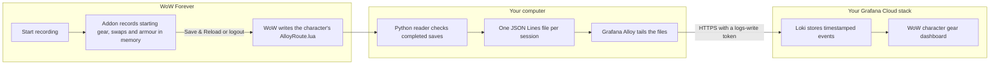

# From a gear swap to Grafana

Alloy Route records the character you are playing. A swap happens in game, WoW saves it at the next reload or logout, and Grafana shows it at **the time you equipped the item**. You can swap the same slot several times between saves. The optional Battle.net profile tracker and the simulated local journey run separately from this path.



## One session, three views

These are the synthetic observations in the [gear test session](companion/tests/scenarios/gear.lua). Times are UTC. The names and IDs are test data.

| Time | What happened | What Grafana shows |
| --- | --- | --- |
| 14:13:20 | Recording starts with Training Vest equipped and 42 armour | Starting equipment shows Chest → Training Vest and the other 18 slots. The armour chart starts at 42. |
| 14:14:20 | The player equips Reinforced Vest | Equipment changes shows Chest, Training Vest → Reinforced Vest. The character sheet now reads 55. |
| 14:15:20 | The character sheet changes to 60 without a swap | The chart rises to 60. The equipment table has no new entry. |
| 14:16:20 | The player takes off the vest | Chest changes from Reinforced Vest to Empty. Armour falls to 20. |
| 14:16:50 | The player logs out | WoW writes the completed recording, including the final reading of 20. |

**Starting gear** is the equipment present when you typed `/alloyroute start`. **Total armour** is the effective value on the character sheet, including bonuses. The addon reads it at the start, on equipment and character-stat events, at regular ten-second checks and at save/stop. It records changes and boundary readings. Restricted readings are omitted. A gap between sessions represents time outside the recording.

## What each component handles

**1. WoW writes a per-character save.** The addon uses its own `AlloyRouteRecording` string. A semicolon separates records, a pipe separates fields, and text uses percent encoding. These are four selected rows from the example save, shown on separate lines for readability.

```text
b|1790000000|5|Chest|1001|Training%20Vest
a|1790000000|20|42
c|1790000060|22|Chest|1001|Training%20Vest|1002|Reinforced%20Vest
a|1790000060|23|55
```

The first field identifies starting gear (`b`), an equipment change (`c`), or effective armour (`a`). The next two fields give Unix seconds and the sequence within the session. The header identifies the character and session. The footer gives its end time and row count. The same file can hold multiple sessions. [Full recording format](companion/FORMAT.md)

**2. The reader converts the save to JSON Lines.** Every five seconds the watcher checks `_forever_/WTF/Account/*/*/*/SavedVariables/AlloyRoute.lua`. It parses the saved text as data, checks event order and footer counts, and retries incomplete saves. It publishes a complete file into `exports/` for each session. Reading the same session again leaves its file intact. The vest swap becomes this JSON object, formatted here for readability.

```json
{
  "type": "gear_swap",
  "time": "2026-09-21T14:14:20Z",
  "ts": 1790000060,
  "seq": 22,
  "ts_ns": "1790000060000000022",
  "session_id": "6ab13b809e37",
  "region": "eu",
  "realm": "Fixture",
  "character": "AlloyGearDemo",
  "player_guid": "Player-Test-Gear",
  "slot": "Chest",
  "previous_item_id": 1001,
  "previous_item_name": "Training Vest",
  "item_id": 1002,
  "item_name": "Reinforced Vest"
}
```

**3. Alloy sends the JSON line to Loki.** Alloy uses `ts_ns` as the log timestamp. The sequence offset orders events within the same game-clock second. The local Cloud write token lives in `cloud/.env`. These are the stream labels and structured metadata for the example line.

```json
{
  "stream_labels": {
    "service_name": "wow-alloyroute", "source": "alloyroute-v2",
    "region": "eu", "realm": "Fixture", "character": "AlloyGearDemo"
  },
  "structured_metadata": {"type": "gear_swap", "session_id": "6ab13b809e37"}
}
```

This is a decoded view of the Loki entry. Alloy handles batching, compression and the wire format. Item names, IDs, and the character GUID stay in the JSON body. [Alloy pipeline](cloud/config.alloy)

**4. Grafana queries the saved observations.** Choose a region, realm and character. The dashboard reads `gear_start` for the starting slots, `gear_swap` for the change table and `armor` for the chart. Paste a session ID from either table to isolate one recording. Include its start in the time picker to see the opening equipment. Each panel reads up to 5,000 records per query. For a long history, narrow the date range or select one session.

For example, this Explore query retrieves the vest swaps from the test character. Open any line to see the full JSON payload.

```logql
{service_name="wow-alloyroute",region="eu",realm="Fixture",character="AlloyGearDemo"} | type="gear_swap"
```

## Save limits and retention

The in-game buffer stops at 4,096 data rows or 1,000,000 bytes and warns at 80%. After confirming a session reached Grafana, use `/alloyroute clear` and then `/alloyroute clear confirm` to free the character’s buffer. The reader writes only to the local export directory. Clearing the in-game buffer leaves previously exported files and Loki records intact. Grafana history is available for your stack’s configured Loki retention period. Older saves remain readable and only contain the fields the addon recorded at the time.
