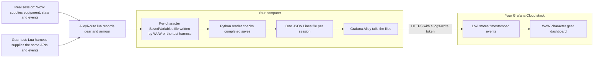
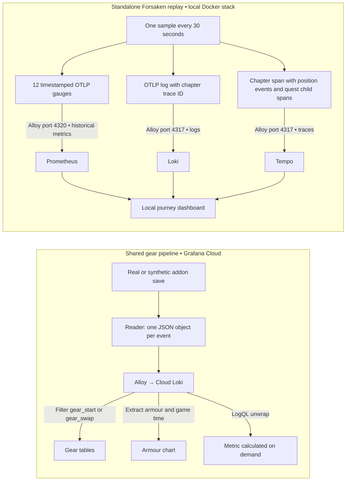

# From a gear swap to Grafana

Alloy Route records the character you are playing. A swap happens in game, WoW saves it at the next reload or logout, and Grafana shows it at **the time you equipped the item**. You can swap the same slot several times between saves. For a gear test, a Lua harness supplies synthetic equipment and armour readings to the very same addon. The game and harness each write the same save format. From that file onward both use the same reader, Alloy configuration, Cloud Loki data source and dashboard. The optional Battle.net profile tracker and standalone Forsaken journey demo have their own inputs.



## One session, three views

These are the synthetic observations in the [gear test session](companion/tests/scenarios/gear.lua). Times are UTC. The names and IDs are test data.

| Time | What happened | What Grafana shows |
| --- | --- | --- |
| 14:13:20 | Recording starts with Training Vest equipped and 42 armour | Starting equipment shows Chest → Training Vest and the other 18 slots. The armour chart starts at 42. |
| 14:14:20 | The player equips Reinforced Vest | Equipment changes shows Chest, Training Vest → Reinforced Vest. The character sheet now reads 55. |
| 14:15:20 | The character sheet changes to 60 without a swap | The chart rises to 60. The equipment table has no new entry. |
| 14:16:20 | The player takes off the vest | Chest changes from Reinforced Vest to Empty. Armour falls to 20. |
| 14:16:50 | The player logs out | WoW writes the completed recording, including the final reading of 20. |

**Starting gear** is the equipment present when you typed `/alloyroute start`. **Total armour** is the effective value on the character sheet, including bonuses. The addon reads it at the start, on equipment and character-stat events, at regular ten-second checks and at save/stop. It records changes and boundary readings. Restricted readings are omitted. A gap between sessions represents time outside the recording.

## What each component handles

**1. WoW writes a per-character save.** The addon uses its own `AlloyRouteRecording` string. A semicolon separates records, a pipe separates fields, and text uses percent encoding. These are four selected rows from the example save, shown on separate lines for readability.

```text
b|1790000000|5|Chest|1001|Training%20Vest
a|1790000000|20|42
c|1790000060|22|Chest|1001|Training%20Vest|1002|Reinforced%20Vest
a|1790000060|23|55
```

The first field identifies starting gear (`b`), an equipment change (`c`), or effective armour (`a`). The next two fields give Unix seconds and the sequence within the session. The header identifies the character and session. The footer gives its end time and row count. The same file can hold multiple sessions. [Full recording format](companion/FORMAT.md)

**2. The reader converts the save to JSON Lines.** Every five seconds the watcher checks `_forever_/WTF/Account/*/*/*/SavedVariables/AlloyRoute.lua`. It parses the saved text as data, checks event order and footer counts, and retries incomplete saves. It publishes a complete file into `exports/` for each session. Reading the same session again leaves its file intact. The vest swap becomes this JSON object, formatted here for readability.

```json
{
  "type": "gear_swap",
  "time": "2026-09-21T14:14:20Z",
  "ts": 1790000060,
  "seq": 22,
  "ts_ns": "1790000060000000022",
  "session_id": "6ab13b809e37",
  "region": "eu",
  "realm": "Fixture",
  "character": "AlloyGearDemo",
  "player_guid": "Player-Test-Gear",
  "slot": "Chest",
  "previous_item_id": 1001,
  "previous_item_name": "Training Vest",
  "item_id": 1002,
  "item_name": "Reinforced Vest"
}
```

**3. Alloy sends the JSON line to Loki.** Alloy uses `ts_ns` as the log timestamp. The sequence offset orders events within the same game-clock second. The local Cloud write token lives in `cloud/.env`. These are the stream labels and structured metadata for the example line.

```json
{
  "stream_labels": {
    "service_name": "wow-alloyroute", "source": "alloyroute-v2",
    "region": "eu", "realm": "Fixture", "character": "AlloyGearDemo"
  },
  "structured_metadata": {"type": "gear_swap", "session_id": "6ab13b809e37"}
}
```

This is a decoded view of the Loki entry. Alloy handles batching, compression and the wire format. Item names, IDs, and the character GUID stay in the JSON body. [Alloy pipeline](cloud/config.alloy)

**4. Grafana queries the saved observations.** Choose a region, realm and character. The dashboard reads `gear_start` for the starting slots, `gear_swap` for the change table and `armor` for the chart. Paste a session ID from either table to isolate one recording. Include its start in the time picker to see the opening equipment. Each panel reads up to 5,000 records per query. For a long history, narrow the date range or select one session.

For example, this Explore query retrieves the vest swaps from the test character. Open any line to see the full JSON payload.

```logql
{service_name="wow-alloyroute",region="eu",realm="Fixture",character="AlloyGearDemo"} | type="gear_swap"
```

## Where metrics, logs and traces come from

Both real gear sessions and the synthetic gear test use the Cloud pipeline. Grafana can turn a numeric field in either recording into a time series at query time. The standalone Forsaken replay is a separate example: it builds native OpenTelemetry messages directly from a generated timeline. It does not run the addon or produce a SavedVariables file.



### A metric from your character's logs

The Cloud armour panel extracts the time and number from each `armor` record, draws one step per recorded change and separates sessions. To use the same records in a **metric query** in Explore, select Loki and run:

```logql
last_over_time(
  {service_name="wow-alloyroute", realm="Fixture", character="AlloyGearDemo"}
  | type="armor"
  | json armor="armor"
  | unwrap armor
  | __error__="" [1m]
) by (character, realm, region)
```

Replace the realm and character for your own data. At each query step, Loki selects the latest numeric armour value observed in the previous minute. A minute without an observation produces a gap. In the verified example this yields **42 → 55 → 60 → 20**. The Cloud gear collector sends only to Loki. It does not create a Prometheus series or send gear spans to Tempo.

### One local observation in three payloads

The simulator's first sample places Vesper Ashvale at level 1 in Deathknell crypt. These excerpts come from running the exporter with run ID `1790000000`. They show selected fields from the decoded OTLP messages. On the wire the simulator sends protobuf batches.

**Metric.** The exporter creates one gauge point per numeric measurement. Level, for example, is 1 at the original gameplay timestamp. Prometheus can plot `wow_journey_level{character="vesper-ashvale",run="1790000000"}`. Choose your local run ID to query a different replay.

```json
{
  "name": "wow_journey_level",
  "gauge": {"dataPoints": [{
    "timeUnixNano": "1790000000000000000", "asInt": "1",
    "attributes": [
      {"key":"character","value":{"stringValue":"vesper-ashvale"}},
      {"key":"run","value":{"stringValue":"1790000000"}}
    ]
  }]}
}
```

**Log.** The same sample becomes an INFO log. The body contains JSON text with the event, character and map position. The OTLP log envelope also carries the trace and span IDs. In local Loki, `{service_name="wow-journey-simulator"} | json | quest_id="363"` finds the quest.

```json
{
  "timeUnixNano": "1790000000000000000",
  "severityText": "INFO",
  "traceId": "4dd330de8ed67e4fac091dd49ff4074e",
  "spanId": "753213beeb54f8e0",
  "body": {"stringValue":"{\"run\":\"1790000000\",\"character\":\"Vesper Ashvale\",\"minute\":0.0,\"level\":1,\"place\":\"Deathknell crypt\",\"activity\":\"Awakening\",\"event\":\"Awoke in the crypt\",\"who\":\"Undertaker Mordo\",\"quest_id\":363,\"x\":30.0,\"y\":71.6,\"latitude\":-45.940393663323405,\"longitude\":-72.0}"}
}
```

**Trace.** The exporter groups the sample into a chapter. The Deathknell root span lasts 25 minutes and contains a timestamped `map.position` event for each sample. The opening quest becomes a child span. Its span ID matches the log above, so you can move from a single quest record to its surrounding chapter. In local Tempo, search `{ resource.service.name = "wow-journey-simulator" && name = "Deathknell" }`.

```json
[
  {"name":"Deathknell","traceId":"4dd330de8ed67e4fac091dd49ff4074e","spanId":"76b26e13cd716a8b",
   "startTimeUnixNano":"1790000000000000000","endTimeUnixNano":"1790001500000000000",
   "events":[{"name":"map.position","timeUnixNano":"1790000000000000000"}]},
  {"name":"Awoke in the crypt","traceId":"4dd330de8ed67e4fac091dd49ff4074e",
   "spanId":"753213beeb54f8e0","parentSpanId":"76b26e13cd716a8b"}
]
```

The optional Battle.net tracker has a separate live path in the local stack. A profile poll produces level, average item-level and achievement gauges, logs changes or failures, and wraps its HTTP calls in a `character.poll` trace. These three signals enter Alloy on port 4317. The older v1 route importer can also turn consecutive positions in a zone into a `character.zone_visit` span. The v2 gear reader uses the Cloud path shown above. [Simulator exporter](app/journey_telemetry.py) · [Local Alloy pipelines](config.alloy) · [Profile tracker](app/tracker.py) · [v1 route spans](app/routes.py)

## Save limits and retention

The in-game buffer stops at 4,096 data rows or 1,000,000 bytes and warns at 80%. After confirming a session reached Grafana, use `/alloyroute clear` and then `/alloyroute clear confirm` to free the character’s buffer. The reader writes only to the local export directory. Clearing the in-game buffer leaves previously exported files and Loki records intact. Grafana history is available for your stack’s configured Loki retention period. Older saves remain readable and only contain the fields the addon recorded at the time.
