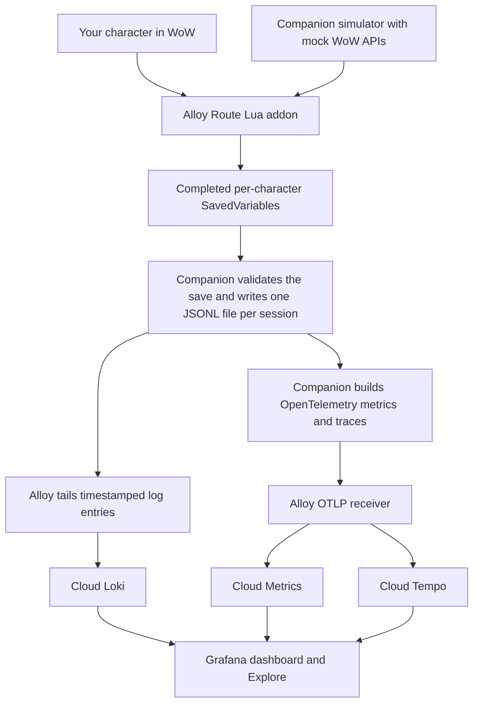
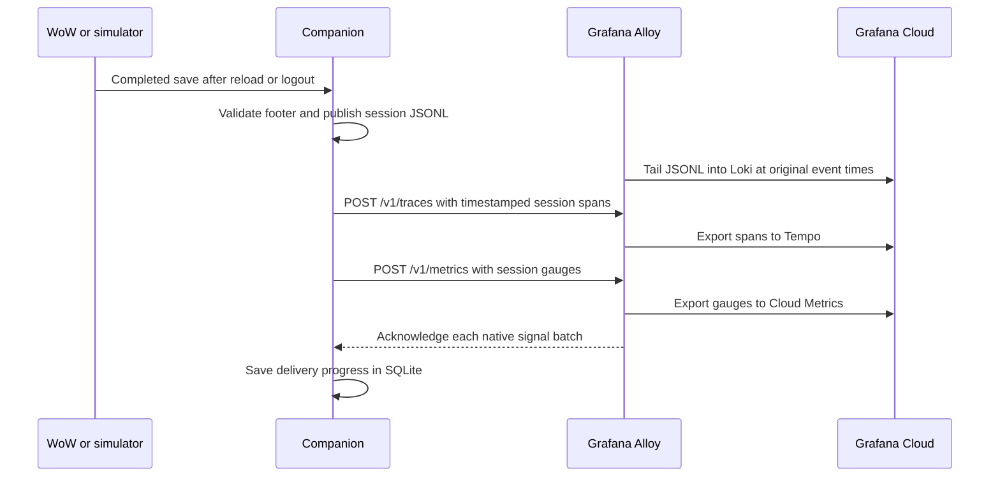

# From gameplay to Grafana

The Lua addon captures what the game exposes. The companion runs outside WoW and turns the saved recording into telemetry. Selecting a mode changes who supplies the game events. Both modes use the same Lua recorder, file format, exporter and dashboard.



## One session, three views

These are the synthetic observations in the [gear test session](companion/simulation/gear.lua). Times are UTC. The names and IDs are test data.

| Time | What happened | What Grafana shows |
| --- | --- | --- |
| 14:13:20 | Recording starts with Training Vest equipped and 42 armour | Starting equipment shows Chest → Training Vest and the other 18 slots. The armour chart starts at 42. |
| 14:14:20 | The player equips Reinforced Vest | Equipment changes shows Chest, Training Vest → Reinforced Vest. The character sheet now reads 55. |
| 14:15:20 | The character sheet changes to 60 without a swap | The chart rises to 60. The equipment table has no new entry. |
| 14:16:20 | The player takes off the vest | Chest changes from Reinforced Vest to Empty. Armour falls to 20. |
| 14:16:50 | The player logs out | WoW writes the completed recording, including the final reading of 20. |

**Starting gear** is the equipment present when you typed `/alloyroute start`. **Total armour** is the effective value on the character sheet, including bonuses. The addon reads it at the start, on equipment and character-stat events, at regular ten-second checks and at save/stop. It records changes and boundary readings. Restricted readings are omitted. A gap between sessions represents time outside the recording.

## What each component handles

**1. WoW writes a per-character save.** The addon uses its own `AlloyRouteRecording` string. A semicolon separates records, a pipe separates fields, and text uses percent encoding. These are four selected rows from the example save, shown on separate lines for readability.

```text
b|1790000000|5|Chest|1001|Training%20Vest
a|1790000000|20|42
c|1790000060|22|Chest|1001|Training%20Vest|1002|Reinforced%20Vest
a|1790000060|23|55
```

The first field identifies starting gear (`b`), an equipment change (`c`), or effective armour (`a`). The next two fields give Unix seconds and the sequence within the session. The header identifies the character and session. The footer gives its end time and row count. The same file can hold multiple sessions. [Full recording format](companion/FORMAT.md)

**2. The reader converts the save to JSON Lines.** By default, every five seconds the watcher checks `_forever_/WTF/Account/*/*/*/SavedVariables/AlloyRoute.lua`. It parses the saved text as data, checks event order and footer counts, and retries incomplete saves. It publishes a complete file into `exports/` for each session. Reading the same session again leaves its file intact. The vest swap becomes this JSON object, formatted here for readability.

```json
{
  "type": "gear_swap",
  "time": "2026-09-21T14:14:20Z",
  "ts": 1790000060,
  "seq": 22,
  "ts_ns": "1790000060000000022",
  "session_id": "6ab13b809e37",
  "region": "eu",
  "realm": "Fixture",
  "character": "AlloyGearDemo",
  "player_guid": "Player-Test-Gear",
  "slot": "Chest",
  "previous_item_id": 1001,
  "previous_item_name": "Training Vest",
  "item_id": 1002,
  "item_name": "Reinforced Vest"
}
```

**3. Alloy sends the JSON line to Loki.** Alloy uses `ts_ns` as the log timestamp. The sequence offset orders events within the same game-clock second. The local Cloud write token lives in `cloud/.env`. These are the stream labels and structured metadata for the example line.

```json
{
  "stream_labels": {
    "service_name": "wow-alloyroute", "source": "alloyroute-v2",
    "region": "eu", "realm": "Fixture", "character": "AlloyGearDemo"
  },
  "structured_metadata": {"type": "gear_swap", "session_id": "6ab13b809e37"}
}
```

This is a decoded view of the Loki entry. Alloy handles batching, compression and the wire format. Item names, IDs, and the character GUID stay in the JSON body. [Alloy pipeline](cloud/config.alloy)

**4. Grafana queries the saved observations.** Choose a region, realm and character. The dashboard reads `gear_start` for the starting slots, `gear_swap` for the change table and `armor` for the chart. Paste a session ID from either table to isolate one recording. Include its start in the time picker to see the opening equipment. The Loki panels read up to 5,000 records per query. For a long history, narrow the date range or select one session.

For example, this Explore query retrieves the vest swaps from the test character. Open any line to see the full JSON payload.

```logql
{service_name="wow-alloyroute",region="eu",realm="Fixture",character="AlloyGearDemo"} | type="gear_swap"
```

## What happens to one saved session



**Metrics.** Cloud Metrics enforces a historical ingestion window. The companion summarizes the complete session at export time so that a long play session still contributes all its observations. The following is one point from the gear example’s decoded OTLP metric payload. At this export the starting, lowest and highest armour gauges are 42, 20 and 60. The final armour gauge is 20. The gameplay-time chart in Loki shows exactly when each change occurred.

```json
{"name":"wow_addon_checkpoint_armor","gauge":{"dataPoints":[{
  "timeUnixNano":"1790000220000000000","asInt":"20",
  "attributes":[{"key":"region","value":{"stringValue":"eu"}},
                {"key":"realm","value":{"stringValue":"Fixture"}},
                {"key":"character","value":{"stringValue":"AlloyGearDemo"}}]
}]}}
```

**Traces.** The companion turns intervals into spans and attaches point observations as events. The `wow.session` root covers gameplay time. Each contiguous visit to a recorded zone gets a span. Moving within the zone adds coordinate samples. Returning to a zone starts a new visit. The companion nests a combat span inside its visit when both boundaries fit there. A fight that crosses a zone boundary sits under the session.

An accepted quest opens a span. Its turn-in closes it. If the recording ends first, the span carries `wow.quest_end=session_end`, so the displayed duration covers only the observed interval. A turn-in whose acceptance predates the session remains a timestamped event. Long visits group observations into batches of up to 64 events to preserve their detail.

This excerpt shows the zone span containing the vest swap in the gear example.

```json
{"name":"Visit · Test zone","traceId":"05df16880983eb29a3157c66d10fbf47",
 "spanId":"fd01658a3c92effd","parentSpanId":"d03e6e8657117d74",
 "events":[{"name":"equipment.change","timeUnixNano":"1790000060000000022",
 "attributes":[{"key":"wow.slot","value":{"stringValue":"Chest"}},
               {"key":"wow.item_id","value":{"intValue":"1002"}}]}]}
```

Upgrading rebuilds the activity traces from local JSONL exports with versioned trace IDs. Previous Tempo links remain valid for the stack’s retention period. The dashboard and companion open the new traces. Logs and metrics keep their existing delivery checkpoints.

**Combat and quests.** Entering or leaving combat creates a `combat` log with the state, game time and available map coordinates. The corresponding trace events are `combat.entered` and `combat.left`. Recording can start during combat or stop before it ends. The exporter counts observed entries and clips observed combat time to the recording. Quest records become `quest.accepted` and `quest.turned_in` trace events, with IDs, titles, NPC details and reported rewards when available. The dashboard’s **Combat and quest journal** puts both activities in gameplay order. Open the session trace to see them alongside `map.position` events. Saved coordinates are in hundredths of a map percent.

The companion writes immutable JSONL files and keeps separate delivery progress for native metrics and traces. Its acknowledgements identify successful requests to the local collector. Grafana queries show what the remote backends actually retained. Logs and traces keep their gameplay timestamps, so their maximum accepted age and retention depend on the stack. [Signal exporter](companion/export_signals.py) · [Alloy configuration](cloud/config.alloy)

## Save limits and retention

The addon stops at 4,096 data rows or 1,000,000 bytes and warns at 80%. Confirm delivery before clearing the character’s buffer. Local exports and Cloud history survive clearing the in-game recording. Older saves retain the fields their addon version captured. The optional Battle.net profile tracker polls public profiles independently. The optional local atlas consumes a replay generated by the companion simulator.
